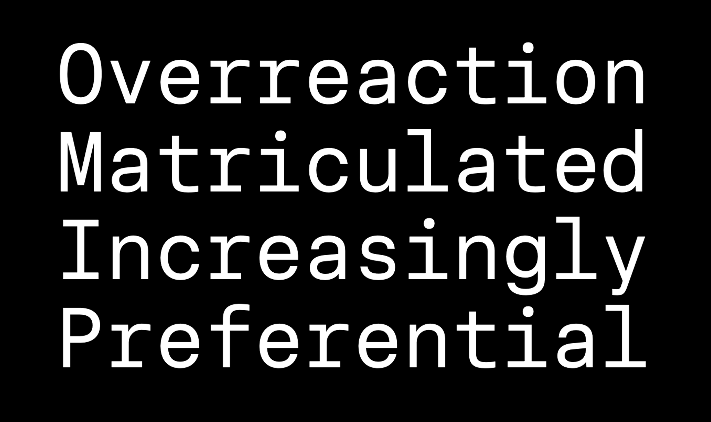

# Designali Mono

A beautiful monospace font for design and code by [Designali](https://designali.in).

Designali Mono is available in 8 weights (Thin → ExtraBold) as static TTF/OTF, a variable font, webfonts (WOFF2), and a strictly monospaced **Designali Mono Term** build for terminals.

## Installation

Download the latest release from the [releases page](https://github.com/designali/fonts) and install the fonts on your system.

### Web

```css
@font-face {
  font-family: "Designali Mono";
  src: url("DesignaliMono[wght].woff2") format("woff2-variations");
  font-weight: 100 800;
  font-display: swap;
}

code, pre {
  font-family: "Designali Mono", ui-monospace, monospace;
}
```

## Building

Fonts are built automatically by GitHub Actions - take a look in the "Actions" tab for the latest build.

If you want to build fonts manually on your own computer:

* `make build` will produce font files.
* `make build-term` will produce only Designali Mono Term (terminal build).
* `make test` will run [Fontspector](https://github.com/fonttools/fontspector) quality assurance tests.
* `make proof` will generate HTML proof files.

The proof files and QA tests are also available automatically via GitHub Actions - look at https://designali.github.io/fonts.

## License

This Font Software is licensed under the SIL Open Font License, Version 1.1.
This license is available with a FAQ at
https://openfontlicense.org

## Repository Layout

This font repository structure is inspired by [Unified Font Repository v0.3](https://github.com/unified-font-repository/Unified-Font-Repository), modified for the Google Fonts workflow.
